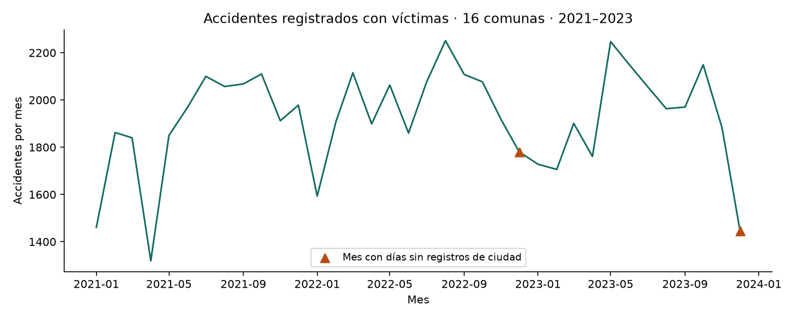
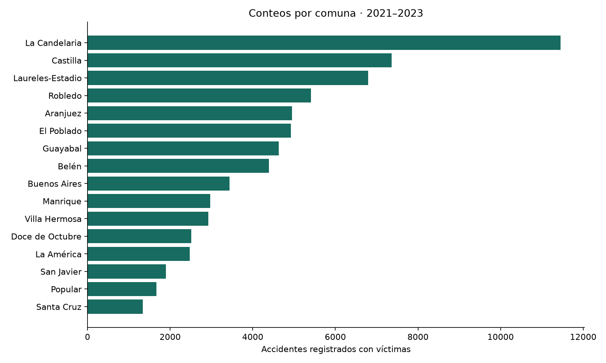
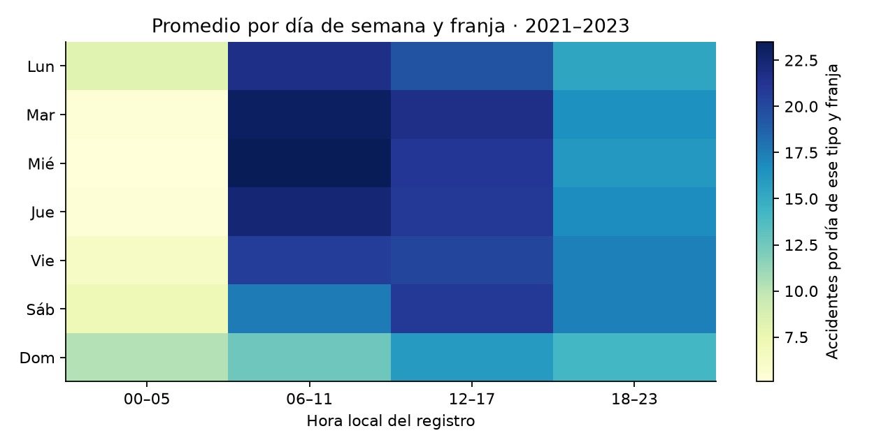

# Diagnóstico y exploración inicial

Resultado reproducible de `python -m data_pipeline.prepare`. Esta etapa prepara datos; no acredita modelos entrenados ni rendimiento predictivo.

## Control de registros

- Original: 702,540 filas.
- Ventana 2021–agosto de 2025: 145,200 filas de todas las gravedades.
- Incidentes con víctimas en las 16 comunas: 106,006.
- Población: 80 combinaciones comuna-año, agregadas desde 269 unidades territoriales.
- Panel diario: 27,264 combinaciones comuna-fecha.
- Días sin registros de ninguna gravedad en la ciudad: 3. Fechas: 2022-12-31, 2023-12-31, 2024-12-31.
- Filas comuna-semana de borde incompleto: 16.
- Filas comuna-semana con target nulo por huecos de fuente: 48.
- Incidentes seleccionados sin coordenadas utilizables en el control preliminar: 5,901; se conservan para conteos.

Las exclusiones disjuntas y hashes de los insumos están en [auditoria.json](auditoria.json). La suma del conteo observado en archivo concilia entre incidentes y las tres escalas. Un total registrado no garantiza completitud administrativa.

## Exploración reservada al entrenamiento

La exploración de patrones usa únicamente 2021–2023, con 69,135 incidentes. La separación temporal es provisional y debe acordarse con el responsable de modelado. La comuna con mayor conteo en ese periodo es La Candelaria; esto no equivale al mayor riesgo individual.

## Límites para interpretar

Las figuras describen registros, no explican causas. Un cero significa ausencia de eventos objetivo registrados, no ausencia demostrada de accidentes. La validación de cobertura por comuna sigue pendiente. Los periodos con huecos o bordes incompletos deben excluirse del modelado de periodos completos.

La población es una proyección para contexto retrospectivo. El archivo indica actualización posterior al final del histórico de accidentes. No debe usarse automáticamente como variable disponible en un pronóstico histórico. Ver [reglas y relación con las materias](../DATOS.md).
